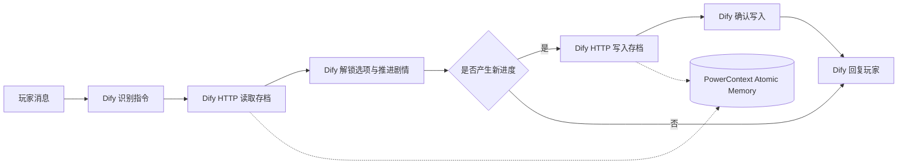

# 雾港留灯

最后一班轮渡驶向雾港，岸边的引航灯却灭了。你只有一幕时间准备。修灯、问潮或送信，都会留下不同的线索。换一个对话回来，值班簿会记住那一晚你做过的事。

## 部署和导入

需要 Git、Python 3.10+、运行 Linux 容器的 Docker 和 Compose 2.24.4+。首次启动会下载 Dify 1.14.2、它的容器镜像以及 PowerContext 1.4.1。使用独立的 Compose 项目。无需模型账号，运行的对话逻辑都在 Dify 工作流内。

1. 在本目录打开终端，运行 `python run.py up`。Windows 若使用 Anaconda，可把 `python` 换成已安装的 Python 路径。
2. 打开 [本地 Dify](http://127.0.0.1:8088/install)，完成首次管理员初始化。
3. 在 Dify 工作室选择 **导入 DSL 文件**，上传 [`fog-harbor.yml`](fog-harbor.yml)。本作品只有这一个 DSL，类型为 Chatflow，DSL 版本为 `0.6.0`。无需填写环境变量或安装模型插件。
4. 进入应用的 **预览** 或点击 **发布** 后打开 WebApp，发送 `开始`。按提示输入加粗的行动词。换对话后发送 `继续 存档码` 即可接着玩。

`python run.py status` 查看服务状态，`python run.py logs` 查看 PowerContext 的存档记录，`python run.py restart-memory` 重启存档服务。`python run.py down` 停止这一套服务，保留存档。若 `8088` 被占用，可用 `python run.py up --port 8089`，然后打开对应端口。

Docker Compose 将 Web 控制台绑定到本机回环地址。工作流的两个 HTTP 节点通过 Dify 的代理访问 Compose 私有网络中的存档服务。PowerContext 本身只在存档容器内监听回环地址，数据库位于 `fog_harbor_data` 卷。参考 [Dify 部署文档](https://docs.dify.ai/en/self-host/deploy/quick-start/docker-compose) 和 [PowerContext 1.4.1 接口](https://github.com/oceanbase/powercontext/blob/powercontext-v1.4.1/openapi/powercontext.yaml)。

## 工作流与存档

Dify 的对话变量保存当前存档码，方便在同一个对话里直接输入行动词。进入新对话时，存档码可用于定位 PowerContext 中的 Atomic Memory。存档内容记录第一幕线索和结局。Dify 每次恢复或推进剧情时都会读它，并依据读出的线索决定开放哪些行动。有效选择写出下一修订，写入成功后才展示新进度。重复请求读取现有修订，过时写入返回冲突并引导玩家恢复。

`memory/server.py` 将受限的 `/load`、`/save` 请求映射为 PowerContext 的 `POST /v1/atomic-memory/list`、创建 Artifact、读取头修订和带 `If-Match` 的更新。PowerContext 的作用域和修订是真实服务生成的。服务端用存档码的 SHA-256 定位记录，日志保留作用域、Artifact ID 和修订。请像保存一张私人的寄存凭证一样保存存档码。

## 验收

详见 [验收步骤和结果](evidence/README.md)。核心路径是开档、修灯、在一个全新对话恢复同一档、用恢复的红镜解锁引航。另两条路线、错误输入、已完结存档和隔离性有独立检查。

DSL 内含可运行的代码节点。修改 `nodes/` 后，可用 `python -m pip install PyYAML==6.0.3` 安装生成工具的依赖，再运行 `python build_dsl.py` 重新导出，并用 `python check_dsl.py` 检查节点源码与导出的一致性及剧情逻辑。
