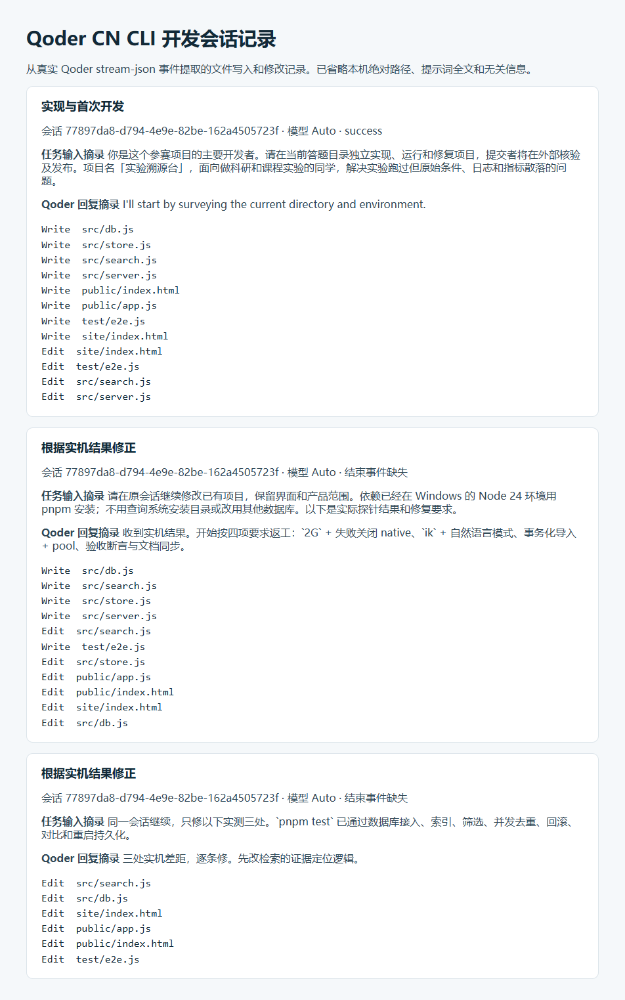

# Qoder 开发记录

Qoder CN CLI 1.1.89 完成应用、数据库接入、界面、文档和验收脚本的主要开发。提交者提供需求、实机验证反馈并核对发布。以下条目从实际 CLI 事件提取。

## 实现与首次开发

会话 `77897da8-d794-4e9e-82be-162a4505723f`，模型 `Auto`。

- `Write  src/db.js`
- `Write  src/store.js`
- `Write  src/search.js`
- `Write  src/server.js`
- `Write  public/index.html`
- `Write  public/app.js`
- `Write  test/e2e.js`
- `Write  site/index.html`
- `Edit  site/index.html`
- `Edit  test/e2e.js`
- `Edit  src/search.js`
- `Edit  src/server.js`

## 根据实机结果修正

会话 `77897da8-d794-4e9e-82be-162a4505723f`，模型 `Auto`。

- `Write  src/db.js`
- `Write  src/search.js`
- `Write  src/store.js`
- `Write  src/server.js`
- `Edit  src/search.js`
- `Write  test/e2e.js`
- `Edit  src/store.js`
- `Edit  public/app.js`
- `Edit  public/index.html`
- `Edit  site/index.html`
- `Edit  src/db.js`

## 根据实机结果修正

会话 `77897da8-d794-4e9e-82be-162a4505723f`，模型 `Auto`。

- `Edit  src/search.js`
- `Edit  src/db.js`
- `Edit  site/index.html`
- `Edit  public/app.js`
- `Edit  public/index.html`
- `Edit  test/e2e.js`

本地执行记录见 [seekdb 验收证据](./seekdb-evidence.md)。账号 UID 通过提测表单提供。
